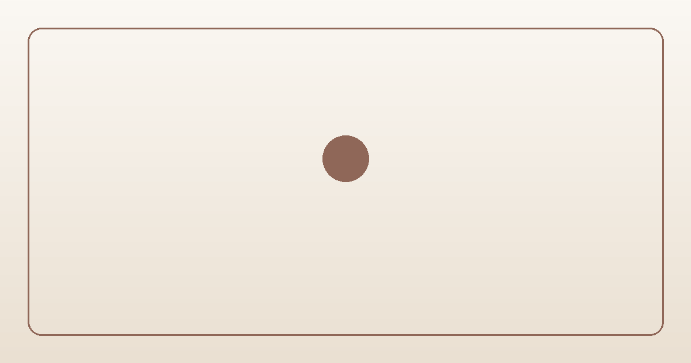

# 📜 감성 타이핑 시집 (Daily Poem · Self-Hosted Edition)

<p align="center">
  <a href="https://poeticecho.github.io/dailypoem/">
    
  </a>
  <a href="https://poeticecho.github.io/dailypoem/stats.html">
    
  </a>
  <a href="https://github.com/PoeticEcho/dailypoem/raw/main/daily-poem-self-hosted.zip">
    
  </a>
  
  
</p>

<p align="center">
  
</p>

> **"기술은 조용히 뒤로 물러나고, 화면 위에는 오직 다정한 문장과 여백만 남는다."**
>
> 지친 하루의 끝에 한 글자씩 천천히 필사되듯 피어나는 한국어 서정시와 시드(Seed) 기반의 잔잔한 재즈·자연의 소리를 담은 **독립형 전자책 & 태블릿 감성 시집 액자**입니다.

👉 **[실시간 웹 시집 감상하기 (Live Demo)](https://poeticecho.github.io/dailypoem/)**  
📊 **[인기 시 TOP 10 & 주간 신작 서재 (stats.html)](https://poeticecho.github.io/dailypoem/stats.html)**  
📦 **[독립형 자체 호스팅 패키지 다운로드 (daily-poem-self-hosted.zip)](https://github.com/PoeticEcho/dailypoem/raw/main/daily-poem-self-hosted.zip)**

---

## 1. 우리의 철학 (Core Philosophy)

### ① 글자(시) 최우선주의와 예술적 조판 (Artistic Typography)
이 앱에서 가장 중요한 주인공은 언제나 **‘시 본문’**입니다.
- **다이내믹 에디토리얼 타이포그래피 엔진**: 시의 전체 줄 수(4~7줄 단시 vs 9~10줄 중시 vs 11줄 이상 장시)와 가장 긴 행의 글자 수를 실시간 계산하여, 글자 포인트(11줄 이상 시 `-0.5pt ~ -0.8pt` 자동 조율), 행간(`line-height`), 연 구분 빈 줄(`.stanza-gap: 0.68em ➔ 0.44em ➔ 0.34em`)을 예술적으로 자동 조판합니다.
- **95% 표출 영역 & 줄바꿈(강제 꺾임) 원천 방지**: 화면 폭의 95%를 온전히 시 표출 영역으로 활용하며, 한 줄에 글자가 많아도 의도치 않은 줄바꿈(`white-space: pre`)이나 상하 잘림이 절대 일어나지 않습니다.
- **본문 서체와 일체화된 활자 커서**: 마지막 글자 끝에서 숨 쉬듯 점멸하는 커서(`|`)는 현재 시의 서체를 그대로 상속받으며, 한글 자모의 시각적 중심에 맞춰 `3px` 아래로 정밀 정렬되어 이질감이 없습니다.

### ② 낭독의 호흡과 필사의 시간성 (Breathing Typography)
빠르게 스크롤하며 소비하는 디지털 텍스트와 달리, 사람이 직접 만년필로 꾹꾹 눌러 적고 소리 내어 읽는 호흡을 코드로 구현했습니다.
글자 사이(82~115ms), 띄어쓰기(150ms), 쉼표(420ms), 줄바꿈(650ms), 마침표(800ms)마다 서로 다른 여운의 시간을 두어 독자의 호흡이 시의 리듬과 자연스럽게 동기화됩니다.

### ③ 완전한 기술적 자립 (100% Self-Hosted & Zero Dependency)
- **서체(Font)**: 5대 정예 한글 서체(`고운돋움`, `고운바탕`, `마루부리`, `본명조`, `나눔명조`)를 내 서버의 `./fonts/` 폴더에 직접 보관하여 서빙합니다.
- **음악(Audio)**: 외부 MP3나 외부 `iframe`에 의존하지 않고, 브라우저 내장 Web Audio API와 결정론적 시드(`Mulberry32 PRNG`, 기본 `seed=2494034659`) 알고리즘으로 재즈 화성과 빗소리·새소리를 실시간 자가 합성합니다.
- **시(Poetry)**: 정밀 교정된 240편에 더해 **최대 7줄 이내의 짧고 여운 깊은 힐링 단시 100편**을 추가 수록하여 총 **340편**으로 출발하며, 매일 오전 10시 자동 큐레이션을 통해 **총 1,000편**의 시를 내 저장소에 영구 축적합니다.
- **브랜드 에셋(Favicon & OG Image)**: 카카오톡·슬랙의 300KB 용량 제한을 여유 있게 통과하는 초경량 자체 호스팅 PNG 에셋(`favicon.png` 1.6KB, `apple-touch-icon.png` 3.7KB, `og-image.png` 25.9KB)을 기본 탑재했습니다.

---

## 2. 조작 방식 · 공유 · 공감(♥) · 서재 통계 (`index.html`, `stats.html`)

### ① 전자책(E-Reader) 3분할 터치 & 1회성 안내 & 더블탭 공감(♥)
```
┌─────────────────┬───────────────────────────┬─────────────────┐
│   좌측 (28%)    │        중앙 (44%)         │   우측 (28%)    │
│    ⏮ 이전 시    │  1회 탭: ⏸/▶ 자동 넘김   │    ⏭ 다음 시    │
│  (1회 안내 표출)│  2회 탭: 💖 하트 공감 저장│  (1회 안내 표출)│
└─────────────────┴───────────────────────────┴─────────────────┘
```
- **구역별 최초 1회 가이드 표출**: 좌측 탭, 중앙부, 우측 탭 각각의 안내 메시지는 사용자가 처음 인식할 때 **딱 1회만 표출**된 뒤 영구적으로 숨겨져 시 감상을 방해하지 않습니다.
- **인스타그램 스타일 중앙 더블탭 하트(`♥`)**: 마음에 와닿는 시에서 화면 중앙을 두 번 클릭(더블탭)하면 본 화면에는 숫자 노출 없이 따뜻한 하트 애니메이션만 피어나며, 데이터는 서재 통계용으로 조용히 누적됩니다.
- **현재 시 공유하기 (`?poem=번호&autoplay=0`)**: 우상단 설정 메뉴 최상단의 **‘현재 시 공유하기’**를 누르면 현재 시의 전용 링크가 공유·복사됩니다. 공유받은 사람이 링크를 열면 **자동 감상 기능이 꺼진 상태**로 해당 시가 고정되어 여유롭게 읽고 스스로 조작할 수 있습니다.

### ② 서재 & 통계 페이지 (`stats.html`)
- 전체 시집과 동일한 한지(`#FBF8F3`)·밤하늘(`#181A20`) 감성 디자인과 5대 정예 서체로 통일된 공개 통계 페이지입니다.
- **💖 공감 하트 1위 ~ 10위 (TOP 10)**: 독자들의 더블탭 공감 수가 가장 높은 인기 시 1위부터 10위까지를 순위별로 감상하고 바로 액자로 열거나 공유할 수 있습니다.
- **🌿 지난 7일 동안 올라온 최신 시**: 최근 7일 동안 새로 생성·수록된 따끈따끈한 신작 시들을 등록일과 함께 모아 볼 수 있습니다.

---

## 3. 설치 및 자체 호스팅 실행 가이드

```bash
# 1. 최초 1회: 5대 정예 서체(.woff2)를 ./fonts/ 폴더로 다운로드하여 외부 의존성 제거
python setup_self_hosted.py

# 2. 로컬 웹서버 구동 (또는 NAS / Nginx / GitHub Pages / Netlify에 그대로 배포)
python -m http.server 8080

# 3. 새로운 힐링 단시(4~7줄) 수동 생성 테스트 (환경 변수에 GEMINI_API_KEY 설정 시)
GEMINI_API_KEY="your_api_key" POEM_COUNT=1 python generate_poem.py
```

### 폴더 구조
```text
├── index.html                   # 독립형 전자책 터치 시집 & 더블탭 공감 & 공유 & 내장 Pixelmood
├── stats.html                   # 누구나 볼 수 있는 서재 통계 (공감 하트 TOP 10 & 지난 7일 신작 시)
├── reflections.json             # 5대 정예 서체·등록일·공감 수가 포함된 감성 시 340편 (목표 1,000편)
├── favicon.png                  # 브라우저 탭 파비콘 (64x64, 1.6KB 초경량 PNG)
├── apple-touch-icon.png         # 모바일/태블릿 홈 화면 아이콘 (180x180, 3.7KB 초경량 PNG)
├── og-image.png                 # 카카오톡·SNS 공유용 오픈그래프 썸네일 (1200x630, 25.9KB < 300KB)
├── generate_poem.py             # 4~7줄 힐링 단시 기준·24종 모티프 순환·유사도 검증 시 생성 봇
├── setup_self_hosted.py         # 5대 정예 서체(.woff2) 로컬 ./fonts/ 영구 보관 스크립트
├── daily-poem-self-hosted.zip   # 1-Click 독립 배포용 자체 호스팅 압축 패키지 (에셋 전수 포함)
├── fonts/                       # 로컬 보관된 5대 정예 서체 및 local-fonts.css
├── .github/workflows/
│   └── auto-poem.yml            # GitHub Actions 1,000편 자동 큐레이션 워크플로
└── README.md                    # 철학, 구현 아키텍처 및 운용 가이드 문서
```

---

<p align="center">
  <sub>Made with pure warmth and poetic heart. Dedicated to quiet evenings and gentle mornings.</sub>
</p>
